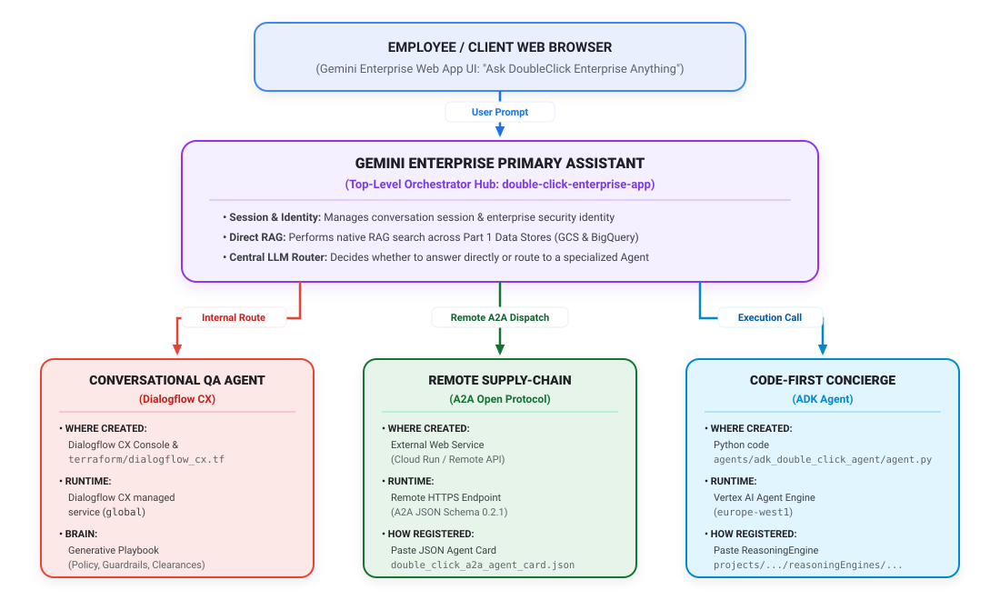

# 🚀 Building Enterprise Agents with Gemini — The “Double-Click” Enterprise Series

Welcome to the official companion repository for the **Building Enterprise Agents with Gemini** Medium series!

This repository follows an **incremental branch-per-article architecture**: each branch corresponds to one part of the 5-part series and builds directly on top of the previous branch, driven by a **single unified `.env` configuration file** at the root of the project.

---

## 🏢 The Business Scenario: Why “DoubleClick Enterprise” Needs Gemini Enterprise

### Why the Name “Double-Click”?
In corporate and consulting slang, to **“double-click”** on a topic means to *drill down, inspect the underlying details, and look beneath the surface*. 

Throughout this series, you step into the role of **Lead AI Architect at DoubleClick Enterprise**—a fast-growing omni-channel retail and B2B technology company with offices in Milan, London, and New York. We named our internal AI assistant **“Double-click”** because its mission is to let any employee—from a Business Analyst to an Account Executive or Site Reliability Engineer—*double-click* into the company’s scattered knowledge and get verified, actionable answers in seconds.

### The Problem: A Classic Case of Enterprise “Data Silos”
Like most real-world organizations, DoubleClick Enterprise doesn't suffer from a lack of data—it suffers from **fragmentation**. Before adopting Gemini Enterprise, employees wasted hours every day hunting across three disconnected data ecosystems:

1. **Unstructured Documents & Archives (Google Cloud Storage / Drive / SharePoint):**
   * **HR & People Policies (`WFH_Policy_Update_V2.txt`):** Employees constantly message HR asking about hybrid work core hours or how to claim the €750 ergonomic home office stipend.
   * **Legal & Client Contracts (`Acme_Corp_Master_Services_Agreement_2026.txt`):** Account Executives preparing for renewal calls have to manually dig through hundreds of PDF Master Services Agreements to check termination clauses, volume discounts, and SLA penalty notes (such as a 14-day delay on *Project Alpha* caused by hardware vendor *CloudNet Hardware Ltd.*).
   * **IT & Security Runbooks (`IT_Security_Onboarding_Playbook.txt`):** Engineers on call need instant answers on Private Service Connect (PSC) routing rules and P1 incident escalation paths.
2. **Structured Operational & Retail Warehouses (BigQuery):**
   * **Project Portfolio Tracking (`double_click_kb.project_db`):** Leadership needs real-time visibility into internal project statuses (`Double-click` is `ACTIVE`, `Phoenix` is `ON_HOLD` pending firewall sign-off, `Alpha` is `DELAYED`), budgets, and owners without writing SQL queries.
   * **Omni-Channel Retail Analytics (`double_click_kb.retail_sales`):** Business analysts need to correlate sales performance across Point-of-Sale (`pos_sales_table`), e-commerce (`website_sales_table`), and mobile (`mobile_app_sales_table`).
3. **Live Third-Party SaaS Tools (Jira / ServiceNow / Confluence / Salesforce):**
   * **Real-Time Ticketing & CRM:** Support tickets, sprint blockers, and customer opportunities change minute-by-minute. Because of strict compliance and data-residency rules, some of these third-party records cannot be copied into a separate storage bucket—they must be queried live via **Federation**, and updated via **Per-User OAuth 2.0 Actions**.

### Why Gemini Enterprise?
DoubleClick Enterprise chose **Gemini Enterprise** (and the **Vertex AI Agent Builder** ecosystem) to build a unified, production-grade AI platform across 5 architectural pillars:
* **Part 1 (Knowledge Base):** Combine **Ingestion (Graph RAG)** over GCS & BigQuery with **Federation** for live zero-copy queries into Jira.
* **Part 2 (Conversational Modeling — *Current Branch*):** Blend deterministic compliance flows (**Dialogflow CX / Conversational Agents**) with autonomous multi-step Python agents (**ADK on Vertex AI Agent Engine**) and remote **A2A** agents.
* **Part 3 (UX/UI & Accessibility):** Deliver a white-labeled, accessible assistant with DoubleClick's custom logo, pinned shortcuts, and granular **Feature Management** governance.
* **Part 4 (Architecture & Monitoring):** Give leadership Looker-powered **Adoption & Quality Analytics**, while giving SREs deep **OpenTelemetry (`Cloud Trace`)** waterfall debugging and continuous **BigQuery / GenAI Evaluations**.
* **Part 5 (Integration & Security):** Enforce strict **Workforce Identity Federation**, **Document-Level ACLs**, and **Per-User OAuth 2.0 Actions**.

---

## 📚 Series Table of Contents & Git Branch Map

| Branch | Main Medium Article (Concepts & Console UI) | Companion EXTRA Article (Code & Terraform Deep-Dive) | What Gets Added in This Branch |
| :--- | :--- | :--- | :--- |
| **`01-knowledge-base-management`** | **[Part 1 — 📚 Knowledge Base Management](part-1-knowledge-base-management.md)** | **[Part 1 EXTRA — Code & Terraform Setup](part-1-extra-code-and-terraform-setup.md)** | • **DoubleClick Enterprise** messy data scenario (`data/unstructured/` & `data/structured/`)<br>• Modular Terraform (`apis.tf`, `storage.tf`, `bigquery.tf`, `discovery_engine.tf`) |
| **`02-conversational-modeling`** *(Current)* | **[Part 2 — 🗣️ Conversational Modeling](part-2-conversational-modeling.md)** | **[Part 2 EXTRA — Agent Code & Terraform Setup](part-2-extra-code-and-terraform-setup.md)** | • **Conversational Agent (Dialogflow CX)** + Generative Playbook (`terraform/dialogflow_cx.tf`)<br>• **Gemini Enterprise App** (`google_discovery_engine_search_engine`) & **Q&A Chat Engine**<br>• **ADK Python Agent** (`agents/adk_double_click_agent/`), IAM (`terraform/vertex_ai_agent.tf`), & **A2A JSON Agent Card** |
| **`03-ux-ui-and-accessibility`** | **Part 3 — 🎨 UX/UI & Accessibility** *(Checkout branch `03-ux-ui-and-accessibility`)* | **Part 3 EXTRA — UI & Widget Terraform Setup** *(Checkout branch `03-ux-ui-and-accessibility`)* | • **Widget & Branding Config** (`terraform/widget_ui.tf` — `google_discovery_engine_widget_config`)<br>• Search UI, Logo, Pinned Shortcuts & Feature Management automation |
| **`04-architecture-and-monitoring`** | **Part 4 — 📈 Architecture & Monitoring** *(Checkout branch `04-architecture-and-monitoring`)* | **Part 4 EXTRA — Observability & Eval Setup** *(Checkout branch `04-architecture-and-monitoring`)* | • **OpenTelemetry Tracing** (`Cloud Trace`) & IAM bindings<br>• **Cloud Logging $\rightarrow$ BigQuery Sink** & **Cloud Monitoring Dashboard** (`terraform/observability.tf`) |
| **`05-integration-and-security`** | **Part 5 — 🛡️ Integration & Security** *(Checkout branch `05-integration-and-security`)* | **Part 5 EXTRA — Security, OAuth & Mock Web Portal** *(Checkout branch `05-integration-and-security`)* | • **Per-User OAuth 2.0 Actions**, **Secret Manager**, & **ACL Config** (`terraform/security.tf`)<br>• **Interactive Mocked Enterprise Intranet Web App (`webapp/`)** |

---

## 🏛️ Multi-Agent Architecture & Conversational Topology (Branch 02)

Below is the multi-agent topology provisioned and configured on branch **`02-conversational-modeling`**. 
The editable diagram source is stored in [`diagrams/part_2_conversational_architecture.drawio`](diagrams/part_2_conversational_architecture.drawio) (open directly in [diagrams.net / Draw.io](https://app.diagrams.net/)):




### How Each Component Operates:
1. **Gemini Enterprise Primary Assistant (Intranet Hub & Router):**
   * Defined in [`terraform/discovery_engine.tf`](terraform/discovery_engine.tf) (`google_discovery_engine_search_engine.gemini_enterprise_app`).
   * The front-door web chat interface grounded directly in the GCS and BigQuery Data Stores from Part 1. Serves as the central LLM router evaluating whether an employee's query can be answered via RAG or must be dispatched to a specialized sub-agent.
2. **Conversational QA Agent (Dialogflow CX & Generative Playbook):**
   * Defined in [`terraform/dialogflow_cx.tf`](terraform/dialogflow_cx.tf) (`google_dialogflow_cx_agent.double_click_cx_agent` and `google_dialogflow_cx_playbook.double_click_concierge_playbook`).
   * Managed in Google Cloud Dialogflow CX in region `global`. The Generative Playbook acts as its brain, providing conversational guardrails (e.g., restricting *Project Phoenix* inquiries without Security Clearance Level 2) and structured multi-turn guidance.
3. **Remote Supply-Chain A2A Agent (Agent-to-Agent Protocol):**
   * Represented by its contract in [`agents/a2a_agent_card/double_click_a2a_agent_card.json`](agents/a2a_agent_card/double_click_a2a_agent_card.json).
   * **The JSON Agent Card is NOT code**—it is an open A2A specification manifest (`"protocolVersion": "0.2.1"`) containing the agent's identity, remote HTTPS URL, and skill trigger examples. Gemini Enterprise routes queries (e.g., supplier bottleneck checks) across the network to this remote service via HTTPS.
4. **Code-First Concierge (ADK Agent on Vertex AI Agent Engine):**
   * Code in [`agents/adk_double_click_agent/agent.py`](agents/adk_double_click_agent/agent.py), deployed via [`agents/adk_double_click_agent/deploy_agent_engine.py`](agents/adk_double_click_agent/deploy_agent_engine.py).
   * Runs on Vertex AI Agent Engine (`europe-west1`) under dedicated Service Account `double-click-adk-agent-sa` (`terraform/vertex_ai_agent.tf`). Executes deterministic Python logic, exact contract discount math, and BigQuery lookups.

---

## 🛠️ How to Set Up the Infrastructure (Branch `02-conversational-modeling`)

All infrastructure across every branch is controlled by a **single `.env` file** in the root directory (git-ignored so your private project ID is never committed).

### Step 0: Authenticate with Google Cloud
Before running the setup script, authenticate both your `gcloud` CLI session and your Terraform Application Default Credentials (ADC):
```bash
gcloud auth login
gcloud auth application-default login
```

### Step 1: Configure `.env`
All infrastructure parameters across the series are driven by the single root `.env` file (copied from `.env.example`):

```bash
cp .env.example .env
```

Ensure your `.env` contains your project and Part 2 configuration:

```ini
# Core Google Cloud Settings
PROJECT_ID="your-gcp-project-id"
REGION="europe-west1"
DISCOVERY_ENGINE_LOCATION="global"

# DoubleClick Enterprise Branding & App Naming
APP_NAME="double-click"
COMPANY_NAME="DoubleClick Enterprise"

# Part 1: Knowledge Base Management (Ingestion + Federation)
BQ_DATASET_ID="double_click_kb"
GCS_BUCKET_SUFFIX="docs-staging"
FEDERATED_CONNECTOR_SOURCE="jira"
ENABLE_FEDERATED_CONNECTOR="false"

# Part 2: Conversational Modeling (Dialogflow CX + ADK Agent Engine + A2A)
DIALOGFLOW_TIME_ZONE="Europe/Rome"
DIALOGFLOW_DEFAULT_LANGUAGE="en"
ADK_AGENT_DISPLAY_NAME="double-click-adk-concierge"
GEMINI_MODEL="gemini-2.5-pro"
```

---

## 🧪 Testing the Code & Validating Infrastructure

Before provisioning or applying changes, run the automated verification suite:

```bash
# 1. Run unit tests on ADK Python tools, validate A2A Agent Card, and validate Terraform:
./scripts/test_infra.sh

# 2. Run a dry-run check (validates Terraform and ADK Agent root_agent):
./scripts/setup_infra.sh --dry-run

# 3. View the Terraform execution plan using variables directly from .env:
./scripts/setup_infra.sh --plan
```

---

## 🚀 Provisioning Infrastructure (Part 1 + Part 2)

Deploy the complete Part 1 and Part 2 infrastructure:

```bash
./scripts/setup_infra.sh
```

**What `./scripts/setup_infra.sh` does on Branch 02:**
1. **Enables Required APIs:** `discoveryengine`, `bigquery`, `storage`, `dialogflow`, `aiplatform`, and `iam`.
2. **Provisions Part 1 Knowledge Base:**
   * GCS bucket (`gs://${PROJECT_ID}-double-click-docs-staging`) with 3 enterprise unstructured documents.
   * BigQuery dataset (`double_click_kb`) and structured tables (`project_db`, `retail_sales`).
   * Discovery Engine Data Stores (Unstructured Graph RAG & Structured BigQuery) and Intranet App (`double-click-enterprise-app`).
3. **Provisions Part 2 Conversational Agents:**
   * **Dialogflow CX Agent** (`double-click_cx_custom_qa_agent`) with Generative Playbook mode (`startPlaybook`).
   * **Generative Playbook** (`DoubleClick Enterprise Knowledge & Policy Concierge`) with 3 grounding rules.
   * **ADK Agent Engine Service Account** (`double-click-adk-agent-sa`) with least-privilege IAM bindings on GCS and BigQuery.
   * Links the Dialogflow CX Agent and Remote A2A Agent Card to the Gemini Enterprise App.
4. **Seeds BigQuery structured tables** and triggers document imports on Discovery Engine.

---

## 🔎 Automated Live Cloud Verification

Verify all live provisioned resources directly on Google Cloud with a single command:

```bash
./scripts/verify_live_infra.sh
```

This script verifies:
* GCS bucket and the 3 unstructured policy documents.
* BigQuery dataset and row counts for `project_db` and `retail_sales`.
* Discovery Engine Unstructured and Structured Data Stores.
* Gemini Enterprise App and connected data stores.
* Dialogflow CX Agent and Generative Playbook in `global` location.
* Connected Conversational Agents inside Gemini Enterprise Assistant.
* ADK Agent Engine Service Account.

---

## 🖥️ How to Verify the Provisioned Resources in the Google Cloud Console UI

After running `./scripts/setup_infra.sh`, inspect the provisioned resources in the Google Cloud Console:

1. **Verify the Gemini Enterprise App & Data Stores:**
   * Open [Vertex AI Search / Gemini Enterprise Apps](https://console.cloud.google.com/gen-app-builder/engines).
   * Confirm that **`DoubleClick Enterprise - Gemini Enterprise App`** (`double-click-enterprise-app`) is listed.
   * Click **Connected data stores** to confirm both `double-click-unstructured-ds` and `double-click-structured-bq-ds` are attached.
2. **Verify the Conversational Agent & Playbook in Dialogflow CX:**
   * Open [Conversational Agents (Dialogflow CX) Console](https://dialogflow.cloud.google.com/cx/projects) and select your project.
   * Select location **`global`** and confirm **`double-click_cx_custom_qa_agent`** exists.
   * Open **Playbooks** to inspect the **`DoubleClick Enterprise Knowledge & Policy Concierge`** Playbook instructions.
3. **Verify the ADK Agent Service Account in IAM:**
   * Open [IAM & Admin — Service Accounts](https://console.cloud.google.com/iam-admin/serviceaccounts).
   * Confirm that **`double-click-adk-agent-sa`** exists.
4. **(Optional) Deploy the Python ADK Agent to Vertex AI Agent Engine:**
   ```bash
   python3 agents/adk_double_click_agent/deploy_agent_engine.py
   ```

---

## ⏭️ Next Step

Switch to the next branch to customize the **Gemini Enterprise UX/UI, Branding, Widget Configuration, and Feature Management**:

```bash
git checkout 03-ux-ui-and-accessibility
```
